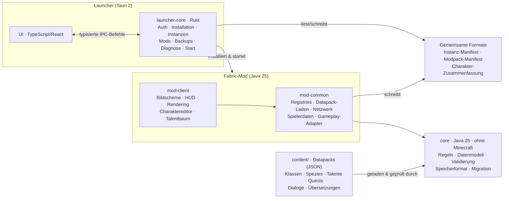

# 2 · Architekturentwurf

## 2.1 Leitprinzipien

1. **Regeln ohne Minecraft.** Alles, was ein RPG-Regelwerk ist (Charakterbogen, Talente, Stufen, Multiclassing, Quest-Zustände, Dialoglogik, Speicherformat), lebt im Modul `core` ohne Minecraft-Abhängigkeit. Es ist in Sekunden testbar und übersteht Minecraft-Updates unverändert.
2. **Dünne Minecraft-Adapter.** Die Mod übersetzt nur: Ereignisse → Regelaufrufe, Regelergebnisse → Attribute, Effekte, Pakete, Bildschirme. Wenn Mojang die Render-API umbaut (wie in 26.1 und 26.2), ist nur dieser Adapter betroffen.
3. **Daten statt Code für Inhalte.** Klassen, Spezies, Talente, Fähigkeiten, Quests, Dialoge, NPCs sind JSON in Datapacks. Neue Inhalte brauchen keinen Java-Code, nur neue *Mechanik-Typen* (z. B. ein neuer Modifikator) brauchen Code.
4. **Server-autoritativ, auch im Einzelspieler.** Der integrierte Server hält den Zustand und prüft jede Aktion; der Client zeigt an und fragt an. Damit ist Multiplayer später eine Erweiterung, kein Umbau.
5. **Wenige, begründete Abhängigkeiten und Mixins.** Fabric API ist gesetzt. Jede weitere Bibliothek und jeder Mixin braucht einen Eintrag mit Begründung in `docs/adr/`. Mixins nur, wo Fabric API keinen Hook bietet.
6. **Sicherheit vor Bequemlichkeit.** Tokens nie im Klartext auf Platte oder in Logs, keine fremden Client-IDs, Spielstände nie ohne Backup verändern, neuere Speicherformate nie überschreiben.

## 2.2 Komponenten



| Komponente | Verantwortung | Technik | Stand |
|---|---|---|---|
| `core` | Regeln, Datenmodell, Lader, Validator, Charakterbogen, Speicherformat | Java 25, Gson | **umgesetzt (Phase 0/3-Grundlage), 58 Tests** |
| `content/` | Basis-Inhaltspaket als Datapack | JSON + Sprachdateien | **umgesetzt (Grundbestand)** |
| `ui` | Präsentationslogik: Talentbaum-, Questtracker-, Dialog-Ansicht, HUD-Regeln, Tastenprüfung, Theme | Java 25, ohne Minecraft | **umgesetzt, 30 Tests** |
| `tools/ui-prototype` | Desktop-Prototyp der Oberflächen B, D, F | Java2D über `ui` | **umgesetzt** |
| `mod` (common) | Datapack-Registries, Spielerdaten-Anhänge, Netzwerkpakete, Anwendung von Modifikatoren, Fähigkeiten, Quests, NPCs | Fabric Loader 0.20.1 + Fabric API 0.165.0+26.3, Minecraft 26.3 | **Skelett baut im CI**; Inhalte werden beim Start geladen |
| `mod` (client) | Charaktereditor, Talentbaum, Zauberbuch, Questjournal, Dialoge, HUD | Vanilla-Screen-API, eigenes kleines Widget-Set | geplant ab M2 |
| `launcher` | Installation, Anmeldung, Instanzen, Mods, Backups, Diagnose | Tauri 2, Rust, TypeScript/React | geplant ab M1.1 |
| Gemeinsame Formate | Austausch Launcher ↔ Mod | JSON mit `schema_version` | Charakterformat v1 umgesetzt |

## 2.3 Schichten innerhalb der Mod

```
net.frosthain.mod
├── FrosthainMod            Einstiegspunkt (ModInitializer): registriert alles, sonst nichts
├── content/                Datapack-Reload → core.ContentLoader → core.ContentValidator
│                           Fehler im Datapack ⇒ klare Meldung im Log + im Spiel für Admins
├── player/                 Spielerdaten-Anhang (Fabric Data Attachment API) mit core.CharacterSheetCodec
├── gameplay/               Adapter: Modifier → Attribute/Resistenzen/Flags; Fähigkeiten; Ressourcen
├── network/                Pakete (Client → Server: Wünsche; Server → Client: Zustand)
├── quest/ npc/ dialogue/   Adapter für die jeweiligen core-Module
└── client/                 nur Client: Screens, HUD, Rendering, Tastenbelegung
```

Regel: Klassen außerhalb von `client/` dürfen keine Client-Klassen importieren (Dedicated-Server-Sicherheit). Das wird per Architekturtest geprüft, sobald die Mod existiert.

## 2.4 Datenfluss am Beispiel „Talent vergeben“

1. Spieler klickt im Talentbaum auf einen Knoten. Der Client fragt lokal `TalentAllocator.checkAllocate` ab und zeigt die Gründe an („Benötigt Stufe 5“, „Nicht kombinierbar mit Bollwerk“) – ohne Server-Rundreise.
2. Bestätigung sendet ein Paket `AllocateTalent(tree, node)` an den Server.
3. Server prüft erneut mit derselben Funktion (der Client wird nie vertraut), speichert den neuen Charakterbogen im Spieleranhang.
4. Server wendet Modifikatoren neu an (Attribute als benannte, entfernbare Attribut-Modifikatoren) und synchronisiert den Bogen an den Client.

## 2.5 Persistenz

| Daten | Ort | Format | Sicherheit |
|---|---|---|---|
| Charakterbogen | Spieleranhang in der Welt (pro Spieler) | `CharacterSheetCodec`, `schema_version` | Migration nur auf Kopie; vor dem Speichern migrierter Daten Backup der Originaldaten; neuere Versionen werden nicht geladen (`FutureVersionException`) |
| Weltzustand (Quests, Ruf, Weltereignisse) | Welt-SavedData | JSON/NBT mit `schema_version` | wie oben |
| Charakter-Zusammenfassung für den Launcher | `<welt>/frosthain/characters/<uuid>.json` | lesbares JSON (Name, Spezies, Klassen, Stufe) | nur lesend für den Launcher |
| Launcher-Einstellungen | `%LOCALAPPDATA%\Frosthain\settings.json` | JSON mit Version | keine Geheimnisse |
| Anmeldedaten | Windows-Anmeldeinformationsverwaltung | DPAPI-geschützt | nie in Dateien oder Logs |
| Backups | `%LOCALAPPDATA%\Frosthain\backups\` | ZIP pro Welt + Manifest | automatische Sicherung vor Updates und Migrationen |

Nach Inhaltsupdates bereinigt `TalentAllocator.sanitize` ungültig gewordene Talente und meldet sie, statt den Spielstand unbrauchbar zu machen. Punkte werden automatisch erstattet.

## 2.6 Inhalts-Pipeline

```
content/<pack>/data/<namespace>/frosthain/<typ>/<pfad>.json   →  ID  <namespace>:<pfad>
content/<pack>/assets/<namespace>/lang/<sprache>.json          →  Übersetzungen
```

- Dasselbe Layout nutzt die Mod als Datapack. Community-Pakete sind normale Datapacks mit eigenem Namespace; spätere Pakete überschreiben frühere (wie bei Minecraft).
- `./gradlew check` lädt und validiert alle Pakete (CI). Die Mod führt dieselbe Prüfung nach jedem `/reload` aus.
- Jede Definition nennt ihre **Quelle**. Quellen ohne Status `approved` blockieren den Inhalt (Lizenz-Sperre).

## 2.7 Internationalisierung

- Code, IDs und Dateinamen: Englisch (`frosthain:fighter`).
- Sichtbare Texte nur über Übersetzungsschlüssel, abgeleitet aus IDs (`class.frosthain.fighter`, `class.frosthain.fighter.desc`).
- `de_de` ist Pflicht (fehlende Schlüssel = Fehler), `en_us` wird geprüft (fehlende Schlüssel = Warnung). Weitere Sprachen: neue Datei, kein Code.

## 2.8 Teststrategie

| Ebene | Werkzeug | Umfang | Stand |
|---|---|---|---|
| Regeln & Datenmodell | JUnit 6 | alle Regeln im `core` | **58 Tests, grün** |
| Inhalte | `:core:validateContent` | jedes ausgelieferte Paket | **läuft in `check`** |
| Serverlogik in Minecraft | Fabric GameTest (headless) | Anwenden von Modifikatoren, Pakete, Speicherung | ab M0.3 |
| Oberflächen | Fabric Client-GameTest mit Screenshots | Editor, Talentbaum, Dialoge | ab M2 |
| Launcher-Logik | `cargo test` mit aufgezeichneten Manifesten | Regeln, Pfade, Prüfsummen, Abhängigkeiten | ab M1.1 |
| Launcher-UI | Playwright gegen die Web-UI | Hauptabläufe | ab M1.2 |
| Ende-zu-Ende | manuell nach Checkliste auf Windows 11 | Installation bis erster Spielstart | je Release |

## 2.9 Erweiterbarkeit und Kompatibilität

- **Addons:** Datapacks mit eigenem Namespace; für neue Mechaniken eine kleine Java-API (`FrosthainApi`) mit stabilen Schnittstellen für Modifikator-Typen, Questauslöser und Dialogbedingungen.
- **Fremd-Mods:** kuratierte Liste getesteter Mods (z. B. Performance-Mods), automatisierter Start-Test im CI mit dieser Liste.
- **Versionierung:** SemVer für FROSTHAIN; jede Version pinnt genau eine Minecraft-Version. Speicherformate tragen eigene Schemaversionen.
