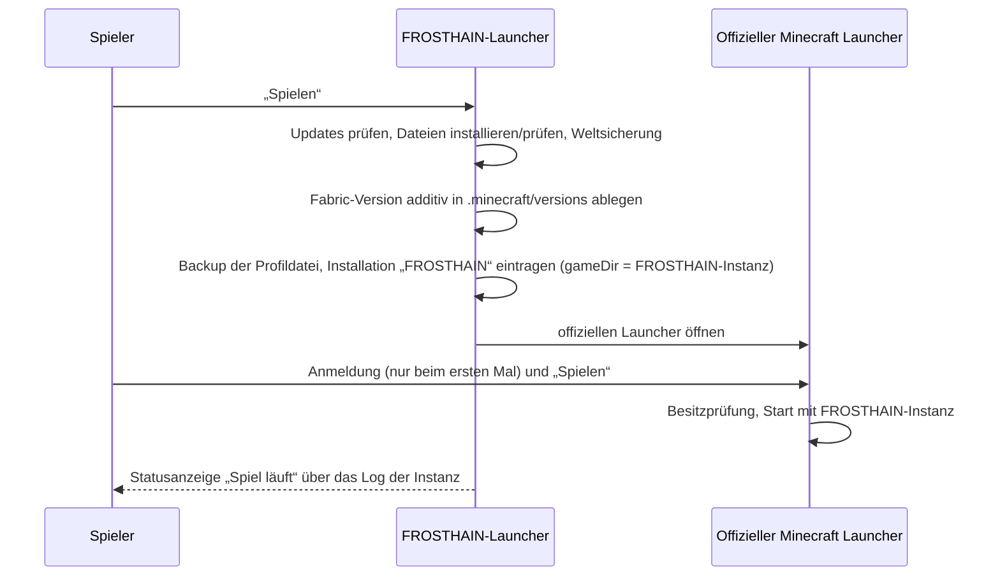

# 4 · Konzept: FROSTHAIN-Launcher

## 4.1 Technologieentscheidung

| Kriterium | Electron | **Tauri 2** | .NET 8 + Avalonia/WinUI | Java + JavaFX |
|---|---|---|---|---|
| Installationsgröße | ~150 MB | **~10–20 MB** (nutzt WebView2 von Windows 11) | ~60–80 MB (self-contained) | ~80 MB + JRE |
| Arbeitsspeicher im Leerlauf | hoch | **niedrig** | mittel | mittel |
| Moderne, frei gestaltbare UI | sehr gut | **sehr gut** (Web-Technik) | gut | eingeschränkt |
| Sicherheitsmodell | Node im Renderer muss aktiv abgesichert werden | **Allow-List pro Befehl, kein Node im UI** | gut | gut |
| Zugriff auf Windows-Anmeldeinformationsverwaltung | über Module | **`keyring`-Crate (DPAPI)** | nativ | über JNA |
| Signierte Selbst-Updates | electron-updater | **eingebauter Updater mit Signaturprüfung** | eigene Lösung | eigene Lösung |
| Testbarkeit der Kernlogik | Jest | **`cargo test`** (auch unter Linux im CI) | xUnit | JUnit |

**Entscheidung:** Tauri 2 mit Rust-Kern und TypeScript/React-Oberfläche ([ADR 0003](adr/0003-launcher-tauri.md)). Die gesamte Installations-, Auth- und Dateilogik liegt in der Rust-Bibliothek `launcher-core`, die ohne Fenster testbar ist. Die Oberfläche ruft nur freigegebene Befehle auf.

## 4.2 Funktionsumfang

| Bereich | Funktion | Meilenstein |
|---|---|---|
| **Installation** | Minecraft-Version laut Modpack-Manifest, Bibliotheken (inkl. Windows-Regeln), Assets, Fabric Loader, FROSTHAIN-Mod; jede Datei per SHA-1/SHA-256 geprüft; parallele Downloads mit Wiederaufnahme | M1.1 |
| **Java** | verwaltete Java-25-Laufzeit pro Instanz (Mojang-Laufzeitkomponente oder Temurin), alternativ eigener Pfad | M1.1 |
| **Instanzen** | eigene Spielverzeichnisse unter `%LOCALAPPDATA%\Frosthain\instances\`, getrennt von `.minecraft`; gemeinsamer Cache für Bibliotheken/Assets | M1.1 |
| **Anmeldung & Start (Brückenmodus)** | Installation „FROSTHAIN“ im offiziellen Minecraft Launcher anlegen/aktualisieren (mit Backup der Profildatei), offiziellen Launcher öffnen; Anmeldung und Start dort | M1.2 |
| **Modpack-Export** | `.mrpack` für Prism Launcher, Modrinth App u. a. | M1.4 |
| ~~Eigene Anmeldung~~ | zurückgestellt: Azure-App funktioniert nicht (ADR 0004) | – |
| **Start & Status** | Startknopf, Fortschritt, „Spiel läuft“, Absturzerkennung | M1.2 |
| **Einstellungen** | RAM (Empfehlung anhand des Systems), Java, JVM-Argumente (Expertenbereich), Auflösung/Vollbild, Grafikvoreinstellung | M1.2 |
| **Modmanager** | FROSTHAIN-Mods (fest), kuratierte optionale Mods, eigene Mods aus Modrinth; aktivieren/deaktivieren; Abhängigkeiten und Konflikte aus `fabric.mod.json` (`depends`, `breaks`, `conflicts`) und Modrinth-Metadaten | M1.4 |
| **Spielstände & Charaktere** | Welten je Instanz mit Charakterübersicht (Name, Spezies, Klassen, Stufe) aus der Charakter-Zusammenfassung der Mod | M2.4 |
| **Sicherung** | automatisch vor jedem Update und jeder Migration, manuell per Knopf; Aufbewahrung konfigurierbar; Wiederherstellung mit Bestätigung | M1.4 |
| **Diagnose** | Launcher- und Spiellog, Absturzbericht-Analyse mit verständlichen deutschen Erklärungen bekannter Fehler (falsche Java-Version, fehlende Abhängigkeit, zu wenig RAM, Mod-Konflikt), Export eines Diagnosepakets mit entfernten Geheimnissen | M1.4 |
| **Updates** | Launcher: signierter Tauri-Updater; Spielinhalte: signiertes Modpack-Manifest | M1.5 |
| **Offline** | wie im offiziellen Launcher (nach früherer Anmeldung) | M1.2 |

## 4.3 Anmeldung: Brückenmodus über den offiziellen Minecraft Launcher

Stand 01.11.2026: Die eigene Azure-App funktioniert nicht. Deshalb meldet sich der Spieler **im offiziellen Minecraft Launcher** an; FROSTHAIN übernimmt alles andere ([ADR 0004](adr/0004-authentifizierung.md)).



| Aspekt | Umsetzung |
|---|---|
| Anmeldung, Besitzprüfung, Tokens | ausschließlich im offiziellen Launcher; FROSTHAIN sieht und speichert keine Zugangsdaten |
| Profildateien | `launcher_profiles.json`, zusätzlich `launcher_profiles_microsoft_store.json` (Store-Variante); vor jeder Änderung Backup; nur der eigene Eintrag wird geändert |
| Unbekanntes Profilformat | nichts schreiben, stattdessen Anleitung zum manuellen Anlegen anzeigen |
| Spielstatus | FROSTHAIN liest das Log der eigenen Instanz (Start, Absturz, Ende) |
| Offline | wie im offiziellen Launcher nach früherer Anmeldung |
| Alternative | `.mrpack`-Export für Prism Launcher, Modrinth App und andere Launcher mit eigener Anmeldung |

**Ausgeschlossen:** fremde Client-IDs, Passwort- oder Tokenabfrage im FROSTHAIN-Launcher, Auslesen von Tokens anderer Launcher, Offline-Konten ohne Kauf.

**Später möglich:** eine eigene Anmeldung über eine freigegebene Registrierung. Der Baustein bleibt als Schnittstelle im Code vorgesehen.

## 4.4 Dateilayout auf Windows

```
%LOCALAPPDATA%\Frosthain\
├── launcher\               Programm (vom Installer, pro Benutzer, ohne Adminrechte)
├── settings.json           Launcher-Einstellungen (keine Geheimnisse)
├── cache\
│   ├── libraries\          gemeinsame Bibliotheken (per Prüfsumme dedupliziert)
│   ├── assets\             gemeinsame Assets
│   └── runtimes\           Java-Laufzeiten
├── instances\
│   └── frosthain-main\     Spielverzeichnis (saves, mods, config, logs, options.txt)
├── backups\                Weltsicherungen mit Manifest
└── logs\                   Launcher-Logs (rotierend, ohne Tokens)
```

Der Ordner `%APPDATA%\.minecraft` anderer Installationen wird **nie** verändert. Einzige Ausnahme ist der Brückenmodus: Er ergänzt dort nach Rückfrage die Installation „FROSTHAIN“ in den Profildateien (vorher Sicherungskopie) und legt die Fabric-Versionsbeschreibung additiv unter `versions\` ab. Welten, Einstellungen und fremde Profile werden nie verändert.

## 4.5 Modpack-Manifest (gemeinsames Format)

```json
{
  "schema_version": 1,
  "frosthain_version": "0.3.0",
  "minecraft": "26.3",
  "fabric_loader": "<aus M0.3>",
  "java_major": 25,
  "mods": [
    { "id": "frosthain", "version": "0.3.0", "url": "https://…", "sha256": "…", "required": true },
    { "id": "fabric-api", "version": "<aus M0.3>", "url": "https://…", "sha256": "…", "required": true }
  ],
  "signature": "<Ed25519-Signatur über den kanonischen Inhalt>"
}
```

Der Launcher installiert nur Manifeste mit gültiger Signatur des FROSTHAIN-Schlüssels.

## 4.6 Oberfläche

Designsprache wie die Mod: Dark Fantasy, dezente Goldakzente, ruhige Animationen ([UI-Leitlinien](05-charaktereditor-konzept.md#59-ui-leitlinien-für-alle-oberflächen)).

| Bildschirm | Inhalt |
|---|---|
| **Start** | großer „Spielen“-Knopf, Status (aktuell / Update verfügbar / installiert …), letzter Charakter, kurze Neuigkeiten |
| **Charaktere & Welten** | Karten je Welt mit Charakterzusammenfassung, Sichern/Wiederherstellen |
| **Mods** | Pflicht-Mods (gesperrt), empfohlene Mods, eigene Mods; Konflikt- und Abhängigkeitshinweise |
| **Einstellungen** | Allgemein · Spiel · Java & Speicher · Erweitert |
| **Diagnose** | Systemprüfung, letzte Logs, Absturzanalyse, „Diagnosepaket erstellen“ |
| **Konto** | angemeldetes Profil, Abmelden, Konto wechseln |

## 4.7 Installation für den Endnutzer (Ziel M1.5)

1. Download von `FrosthainSetup.exe` **oder** ein PowerShell-Befehl, der Installer und Prüfsumme lädt, prüft und startet.
2. Installation pro Benutzer, ohne Adminrechte, Startmenü-Eintrag.
3. Erster Start: Systemprüfung → Installation der Spieldateien → Eintrag im offiziellen Minecraft Launcher → „Spielen“ (Anmeldung beim ersten Mal im offiziellen Launcher).

Kein Gradle, kein Java-Build, keine manuelle Mod-Installation für den Endnutzer.
