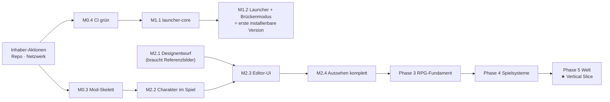

# 7 · Priorisierte Roadmap mit überprüfbaren Meilensteinen

Größen: **S** ≈ 1–3 Arbeitstage · **M** ≈ 1–2 Wochen · **L** ≈ 3–6 Wochen · **XL** > 6 Wochen (grobe Orientierung für eine Person plus Claude Code, keine Zusage).
Status: ✅ erledigt und geprüft · 🔶 erledigt, aber noch nicht in Zielumgebung geprüft · ⏳ offen · ⛔ blockiert durch externe Voraussetzung

**Definition of Done für jeden Meilenstein:** Abnahmekriterien erfüllt und *nachweislich* geprüft (Testlauf, Log oder Screenshot), Dokumentation aktualisiert, keine Funktion als fertig bezeichnet, die nur als Platzhalter existiert.

## Kritischer Pfad und Reihenfolge

## Phase 0 – Technische Vorbereitung

| # | Meilenstein | Abnahmekriterien | Größe | Status |
|---|---|---|---|---|
| M0.1 | Repository, Build, Architekturentscheidungen | Gradle 9.4 + JDK 25 baut; `./gradlew check` grün; ADRs 0001–0010 | S | ✅ |
| M0.2 | Datenmodell, Registry, Validator, Basisinhalte | 58 Tests grün; Validator: 0 Fehler auf `content/`; Lizenz-Sperre per Test belegt | M | ✅ |
| M0.3 | Fabric-Mod-Skelett gegen Minecraft 26.3 | Modul `:mod` baut mit `net.fabricmc.fabric-loom` ✅; Versionen gepinnt ✅; Inhalte werden beim Start über `core` geladen und geprüft (Code ✅, Start ⏳); Dedicated Server ✅ und Client (Client-GameTest, Welt erstellt) ✅ starten im CI mit geladenen Inhalten; Datapack-Reload ⏳; 1 GameTest headless ⏳ | M | 🔶 Teil 1 (Build im CI) erledigt |
| M0.4 | Remote-Repository und CI | GitHub-Repository ✅; CI (Ubuntu + Windows) grün ✅; Gradle-Wrapper-Prüfsumme gegen gradle.org pinnen ⏳; Branch-Schutz für `main` ⏳ | S | 🔶 |

## Phase 1 – Launcher

| # | Meilenstein | Abnahmekriterien | Größe | Status |
|---|---|---|---|---|
| M1.1 | `launcher-core` (Rust) | Versionsmanifest, Versions-JSON, OS-Regeln, Bibliotheken, Assets, Fabric-Profil, verifizierter Download mit Wiederaufnahme; `cargo test` mit aufgezeichneten Manifesten; CI-Job installiert 26.3 + Fabric in ein Temp-Verzeichnis, alle Prüfsummen korrekt | L | ⏳ |
| M1.2 | Launcher-Oberfläche + Brückenmodus (Hauptweg der Anmeldung) | Tauri-App mit Start, Einstellungen, Diagnose-Grundlagen; legt die Installation „FROSTHAIN“ im offiziellen Launcher an (vorher Backup, auch Store-Variante); öffnet den offiziellen Launcher; manueller Test auf Windows 11: Installation → Eintrag sichtbar → Anmeldung im offiziellen Launcher → Spiel startet mit FROSTHAIN-Mod | L | ⏳ |
| M1.3 | ~~Eigene Microsoft-Anmeldung~~ | zurückgestellt: Azure-App funktioniert nicht (ADR 0004); Anmeldung über den offiziellen Launcher (M1.2) | – | zurückgestellt |
| M1.4 | Modmanager, Sicherung, Diagnose, `.mrpack`-Export | Aktivieren/Deaktivieren/Hinzufügen (Modrinth); `.mrpack`-Export importierbar in Prism Launcher; Abhängigkeits- und Konfliktprüfung mit Testfällen; Backup vor jedem Update, Wiederherstellung getestet; Absturzanalyse für mindestens 5 bekannte Fehlerbilder | L | ⏳ |
| M1.5 | Installation und Updates | 🔶 `install-frosthain.ps1` (Bridge-Modus, SHA-256, Backup/Rollback, ohne winget) im CI auf Windows getestet ✅; Installer pro Benutzer; signierter Selbst-Update; signiertes Modpack-Manifest; Test auf frischem Windows 11 | M | ⏳ |

## Phase 2 – Charaktereditor

| # | Meilenstein | Abnahmekriterien | Größe | Status |
|---|---|---|---|---|
| M2.1 | Designentwurf (B, D, F) | UI-Implementierungsplan (docs/10) ✅; interaktiver Prototyp mit Screenshots (docs/prototyp) ✅; Freigabe durch den Inhaber ⏳ | M | 🔶 wartet auf Freigabe |
| M2.2 | Charakter im Spiel | Spieleranhang mit `CharacterSheetCodec` ✅; Server öffnet Editor vor dem ersten Handeln ✅; Erstellung über Pakete, serverseitig geprüft ✅ (Client-GameTest); GameTest: ungültige Anfrage wird abgelehnt ⏳ | M | 🔶 |
| M2.3 | Editor-Oberfläche | 5 von 8 Schritten ✅ (Spezies, Aussehen, Klasse, Hintergrund, Fertig); Vorschau: Spielermodell + Pixel-Porträt ✅, drehen/zoomen ⏳; Schnellstart-Held ✅ (Attribute automatisch); Controller-Navigation ⏳; Client-GameTest mit Screenshots je Schritt ✅ | L | 🔶 |
| M2.4 | Aussehen komplett | `appearance_parts`; Skin-Compositing; Zusatzteile (Ohren, Hörner, Schweif, Hauer); Aussehen im Spiel änderbar; Charakter-Zusammenfassung für den Launcher | L | ⏳ |

## Phase 3 – RPG-Fundament

| # | Meilenstein | Abnahmekriterien | Größe | Status |
|---|---|---|---|---|
| M3.1 | Inhalte prüfen und vervollständigen | SRD-Abgleich mit dem Original-PDF dokumentiert; Klassenmerkmale je Stufe als Daten | M | ⏳ |
| M3.2 | Regeln wirken im Spiel | Modifikatoren → Attribute/Resistenzen; Engine-Funktionen `darkvision`, `lucky`, … umgesetzt (Status `IMPLEMENTED` mit GameTest); EP-Quellen; Stufenaufstieg-Dialog | L | ⏳ |
| M3.3 | Talentbaum-Oberfläche + 6 Kernklassen | Schwenken/Zoomen ✅, Sperrgründe ✅, Vorschau ✅, Bestätigung ✅, Reset ✅ (Taste K, serverseitig geprüft, Client-GameTest); Talentbäume für Krieger ✅ (Daten), Magier, Schurke, Kleriker, Druide, Barde ⏳ | L | 🔶 |
| M3.4 | Multiclassing und Unterklassen im Spiel | Auswahl-UI; Talentbäume der übrigen 6 Klassen; Validator ohne Warnungen | L | ⏳ |

## Phase 4 – Spielsysteme

| # | Meilenstein | Abnahmekriterien | Größe | Status |
|---|---|---|---|---|
| M4.1 | Fähigkeiten und Kampf | Ressourcenleiste ✅, Abklingzeiten ✅, Fähigkeitsleiste ✅ (serverseitig, GameTest), 8 Fähigkeiten mit erster Wirkung ✅ inkl. Ausweichrolle, Statuseffekte ✅ (Vanilla), Werte als Daten ✅, Fähigkeitsdetails ✅, EP aus Kämpfen ✅; Effektketten, Verbesserungen I–III ⏳; Performance-Budget ⏳ | XL | 🔶 |
| M4.2 | Runenmagie | Runen, Kombinationen, klassenübergreifende Synergien; schrittweise Einführung im Spiel | L | ⏳ |
| M4.3 | NPCs und filmische Dialoge | NPC-Entity mit `Appearance` ⏳ (Eldrin vorerst als Dorfbewohner ✅); Dialoggraphen mit Bedingungen/Folgen ✅ (serverseitig, GameTest); Ruf ⏳; HUD-Ausblendung ✅ | L | 🔶 |
| M4.4 | Quests | Auslöser aus Spielereignissen 🔶 (Gespräch, Ort entdecken, Runenstein berühren ✅; Sammeln ⏳), Journal ✅, Quest-HUD (max. 3) ✅, gespeichertes Questlog ✅, EP-Belohnung ✅, Wegweiser mit Entfernung/Richtung ✅, Karte ⏳ | L | 🔶 |
| M4.5 | Gegner und erster Boss | 3 Gegnertypen mit eigenem Verhalten, 1 Boss mit Phasen | L | ⏳ |
| M4.6 | Übrige Menüs | Charakterübersicht, Zauberbuch, Weltchronik, Tastenübersicht, Einstellungen | M | ⏳ |

## Phase 5 – Welt und Story

| # | Meilenstein | Abnahmekriterien | Größe | Status |
|---|---|---|---|---|
| M5.1 | Weltgenerierung Tal | Tal mit Bergring und Meeröffnung erzeugt sich reproduzierbar am Spawn; freie Welt drumherum | L | ⏳ |
| M5.2 | Startdorf und Prolog | Dorf, 6–8 NPCs, Einführung aller Grundsysteme ohne Zwang | XL | ⏳ |
| M5.3 | Hafen, Ruinen, erster Dungeon | geheimer Hafen, 2 Ruinen, 1 Dungeon mit Boss | XL | ⏳ |
| ★ | **Vertical Slice** | 1–2 Stunden zusammenhängend spielbar: Editor → Prolog → Dorf → Dungeon → Boss; 6 Klassen mit Talentbäumen; ~10 Quests; Spieltest mit Protokoll | — | ⏳ |
| M5.4 | Weitere Regionen | Inseln, Fraktionen, Klassenquests, Weltgeheimnisse | XL | ⏳ |

## Phase 6 – Qualität und Erweiterung (laufend, plus eigener Abschluss)

| Bereich | Kriterium |
|---|---|
| Performance | Server-Tick < 5 ms Zusatzlast im Dorf; keine FPS-Einbrüche durch Effekte (Messprotokoll) |
| Kompatibilität | kuratierte Mod-Liste startet im CI gemeinsam |
| Migration | Speicherstände jeder veröffentlichten Version laden in der neuen (Testkorpus) |
| Bedienbarkeit | Spieltest mit D&D-Neulingen: Editor ohne Hilfe abschließbar |
| Dokumentation | Spielerhandbuch, Inhaltsautoren-Handbuch, Entwicklerhandbuch |
| Multiplayer | Bewertung und Plan (Architektur ist vorbereitet) |

## Releaseplan

| Version | Inhalt |
|---|---|
| 0.1 (intern) | RPG-Kern + Basisinhalte ✅ |
| 0.2 | Mod-Skelett + Launcher im Brückenmodus (erste installierbare Version) |
| 0.3 | Charaktereditor |
| 0.4 | Talente, Stufen, Multiclassing im Spiel |
| 0.5 | Fähigkeiten, Kampf, Runen |
| 0.6 | NPCs, Dialoge, Quests |
| 0.7 | Vertical Slice |
| 1.0 | Startregion komplett, 12 Klassen, Feinschliff |
